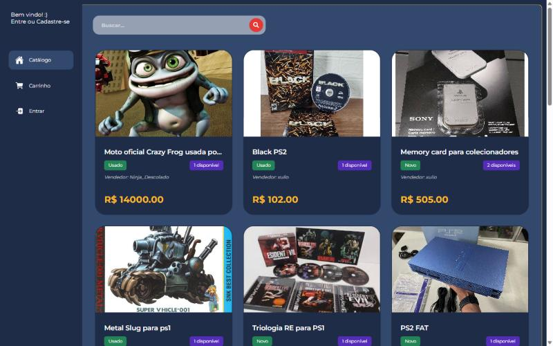

# E-Play

E-commerce para compra e venda de jogos físicos usados, com foco em catálogo de produtos, autenticação de usuários, gestão de anúncios, carrinho e fluxo de pedidos.

**Demonstração:** https://e-play-inky.vercel.app · Projeto acadêmico em equipe do IFRN (Tecnologia em Sistemas para Internet, 2025.2).



## Visão Geral

A E-Play é uma plataforma de marketplace para gamers que desejam vender e comprar jogos usados de forma simples, segura e organizada. O sistema foi desenvolvido em Next.js com PostgreSQL e inclui autenticação, gestão de anúncios, lista de desejos, carrinho de compras, checkout, pedidos, notificações e painel do vendedor.

A aplicação foi pensada para funcionar como uma loja online de produtos físicos, com foco em um nicho específico: jogos de console e PC em segunda mão.

## Funcionalidades Principais

- Catálogo de produtos com busca por título
- Cadastro e autenticação de usuários
- Ativação de conta por token de confirmação
- Recuperação e redefinição de senha
- Criação, edição e remoção de anúncios
- Galeria de imagens por item anunciado
- Lista de desejos
- Carrinho de compras
- Checkout de pedidos
- Painel de pedidos do comprador
- Painel de vendas do vendedor
- Acompanhamento de status e notificações por e-mail
- Armazenamento de imagens via Firebase
- Banco de dados relacional com migrações versionadas

## Stack Tecnológica

- Next.js 13
- React 18
- PostgreSQL 16
- Docker Compose
- Node.js
- node-pg-migrate
- Firebase
- Nodemailer / Resend
- MailCatcher para desenvolvimento
- Jest para testes automatizados
- Prettier para padronização de código

## Arquitetura da Aplicação

A aplicação segue uma estrutura simples e modular:

- Frontend em páginas do Next.js
- API REST interna em pages/api/v1
- Camada de modelo para regras de negócio e acesso ao banco
- Infraestrutura com conexão ao PostgreSQL e containers de apoio
- Migrações de banco para versionamento e evolução do schema

### Estrutura do Projeto

```bash
.
├── components/              # Componentes reutilizáveis da interface
├── hooks/                  # Hooks personalizados do frontend
├── infra/                  # Banco, env, email, webserver, migrações e scripts
│   ├── migrations/
│   └── scripts/
├── models/                 # Modelos de domínio e acesso ao banco
├── pages/
│   ├── api/v1/             # Endpoints da API REST
│   ├── cadastro/
│   ├── carrinho/
│   ├── catalogo/
│   ├── configuracoes/
│   ├── item/
│   ├── login/
│   ├── recuperar-senha/
│   ├── status/
│   └── vendedor/
├── public/
│   └── assets/
├── styles/                 # CSS Modules e estilos globais
├── tests/                  # Testes de integração
├── firebase.js             # Configuração do Firebase
├── middleware.js           # Middleware da aplicação
├── package.json            # Scripts e dependências
├── .env.development        # Variáveis de ambiente de desenvolvimento
├── infra/compose.yaml      # Serviços Docker do projeto
├── jest.config.js
├── jsconfig.json
├── README.md
└── ...
```

## Requisitos

Antes de iniciar, certifique-se de ter instalado:

- Node.js 18+
- npm
- Docker
- Docker Compose

## Configuração do Ambiente

### 1. Clonar o repositório

```bash
git clone <url-do-repositorio>
cd e-play
```

### 2. Instalar dependências

```bash
npm install
```

### 3. Configurar variáveis de ambiente

O projeto já inclui o arquivo `.env.development` com valores padrão de desenvolvimento. Ajuste os valores conforme seu ambiente local.

Exemplo de configuração:

```env
POSTGRES_HOST=localhost
POSTGRES_PORT=5432
POSTGRES_USER=local_user
POSTGRES_DB=local_db
POSTGRES_PASSWORD=local_password
DATABASE_URL=postgres://$POSTGRES_USER:$POSTGRES_PASSWORD@$POSTGRES_HOST:$POSTGRES_PORT/$POSTGRES_DB

EMAIL_SMTP_HOST=localhost
EMAIL_SMTP_PORT=1025
EMAIL_SMTP_USER=
EMAIL_SMTP_PASSWORD=
EMAIL_HTTP_HOST=localhost
EMAIL_HTTP_PORT=1080

WEBSERVER_HOST=http://localhost:3000

DOCUMENT_ENCRYPTION_KEY=...

NEXT_PUBLIC_FIREBASE_KEY=SUA_KEY
NEXT_PUBLIC_FIREBASE_AUTH_DOMAIN=SEU_AUTH_DOMAIN
NEXT_PUBLIC_FIREBASE_PROJECT_ID=SEU_PROJECT_ID
NEXT_PUBLIC_FIREBASE_STORAGE_BUCKET=SEU_STORAGE_BUCKET
NEXT_PUBLIC_FIREBASE_MESSAGING_SENDER_ID=SEU_MESSAGING_SENDER_ID
NEXT_PUBLIC_FIREBASE_APP_ID=SEU_APP_ID
NEXT_PUBLIC_FIREBASE_MEASUREMENT_ID=SEU_MEASUREMENT_ID
```

> Em desenvolvimento, o banco e o serviço de e-mail são provisionados via Docker. O MailCatcher fica disponível em `http://localhost:1080` para visualizar e-mails enviados.

## Executando a Aplicação

### Iniciar serviços de infraestrutura

```bash
npm run services:up
```

### Esperar o banco ficar disponível

```bash
npm run wait-for-database
```

### Rodar as migrações

```bash
npm run migration:up
```

### Iniciar a aplicação em modo de desenvolvimento

```bash
npm run dev
```

A aplicação ficará disponível em:

- Frontend: http://localhost:3000
- MailCatcher: http://localhost:1080
- PostgreSQL: localhost:5432

## Scripts Disponíveis

```bash
npm run dev
```
Executa a subida de serviços, espera o banco, aplica migrações e inicia o Next.js em modo de desenvolvimento.

```bash
npm run services:up
```
Subir os containers do PostgreSQL e MailCatcher.

```bash
npm run services:stop
```
Parar os containers sem remover o estado.

```bash
npm run services:down
```
Desliga e remove os containers.

```bash
npm run migration:create
```
Cria uma nova migração no diretório `infra/migrations`.

```bash
npm run migration:up
```
Aplica as migrações pendentes.

```bash
npm run migration:down
```
Reverte a última migração aplicada.

```bash
npm test
```
Sobe os serviços, inicia o Next.js e executa os testes com Jest.

```bash
npm run test:watch
```
Executa os testes em modo assistido.

```bash
npm run lint:check
```
Valida os arquivos com Prettier.

```bash
npm run lint:fix
```
Aplica formatação automática.

## Banco de Dados e Migrações

A camada de persistência utiliza PostgreSQL e migrações versionadas com `node-pg-migrate`.

Os arquivos de migração ficam em:

```bash
infra/migrations/
```

Exemplos de migrações disponíveis:

- criação de usuários
- categorias
- anúncios/listings
- pedidos
- avaliações
- envios
- sessões
- imagens de anúncios
- tokens de ativação e recuperação de senha
- carrinho e itens do carrinho

Essas migrações são essenciais para criar o schema inicial do marketplace e evoluir a estrutura do sistema com segurança.

## Endpoints da API

A API REST da aplicação está organizada em `pages/api/v1`.

### Usuários e autenticação

- `GET /api/v1/users/[id]` — busca usuário por ID
- `POST /api/v1/users` — cadastro de usuário
- `PATCH /api/v1/users` — atualização de dados do usuário
- `POST /api/v1/sessions` — login e criação de sessão
- `DELETE /api/v1/sessions` — logout
- `GET /api/v1/user` — dados do usuário autenticado
- `PATCH /api/v1/user` — atualização de endereço do usuário

### Ativação e recuperação de senha

- `PATCH /api/v1/activations/[token_id]` — ativação da conta
- `POST /api/v1/passwords/recover` — solicitar recuperação de senha
- `PATCH /api/v1/passwords/reset/[tokenId]` — redefinir senha

### Categorias e anúncios

- `GET /api/v1/categories` — listar categorias
- `GET /api/v1/listings` — listar anúncios ativos
- `POST /api/v1/listings` — criar anúncio
- `GET /api/v1/listings/[id]` — detalhe do anúncio
- `PATCH /api/v1/listings/[id]` — atualizar anúncio
- `DELETE /api/v1/listings/[id]` — remover anúncio
- `GET /api/v1/listings/search/[title]` — buscar anúncios por título

### Carrinho, wishlist e pedidos

- `GET /api/v1/user/cart` — obter carrinho do usuário
- `POST /api/v1/user/cart` — adicionar item ao carrinho
- `PATCH /api/v1/user/cart` — atualizar quantidade ou itens
- `DELETE /api/v1/user/cart` — remover item do carrinho
- `PATCH /api/v1/user/wishlist` — adicionar/remover produto da lista de desejos
- `GET /api/v1/orders` — listar pedidos do usuário
- `POST /api/v1/orders` — criar pedido
- `POST /api/v1/orders/checkout-cart` — finalizar compra do carrinho
- `GET /api/v1/orders/seller` — listar vendas do vendedor
- `GET /api/v1/orders/[id]` — detalhe do pedido
- `PATCH /api/v1/orders/[id]/tracking` — atualizar rastreio/entrega

### Status e diagnósticos

- `GET /api/v1/status` — verifica o estado do sistema e do banco de dados

## Fluxos de Usuário

### Cadastro e ativação

1. Usuário preenche cadastro
2. Sistema cria registro no banco
3. Gera token de ativação
4. Envia e-mail de confirmação
5. Usuário ativa conta via link
6. O acesso ao sistema passa a ficar disponível

### Publicação de anúncio

1. Usuário faz login
2. Acessa painel de anúncios
3. Cria anúncio com título, descrição, preço, condição e imagens
4. O anúncio entra no catálogo como ativo se validado

### Compra

1. Usuário navega pelo catálogo
2. Adiciona itens ao carrinho
3. Finaliza checkout
4. Sistema gera pedido associado ao vendedor e ao comprador
5. Notificações e atualizações de status são enviadas

### Vendas e acompanhamento

1. Vendedor acessa painel de vendas
2. Visualiza pedidos recebidos
3. Atualiza status de envio ou rastreio
4. Cliente acompanha informações e recebe notificações

## Testes

A aplicação possui testes de integração em `tests/integration` e usa Jest como ferramenta principal.

Para executar:

```bash
npm test
```

Os testes cobrem cenários de API e fluxo principal do sistema. O comando já inicia os serviços do Docker e a aplicação para validar comportamento em ambiente próximo do real.

## E-mail em produção sem domínio próprio

A Resend só entrega para qualquer destinatário com um domínio verificado. Sem domínio, use um servidor SMTP comum, como o Gmail, configurando estas variáveis na Vercel (Settings → Environment Variables):

```env
EMAIL_PROVIDER=smtp
EMAIL_SMTP_HOST=smtp.gmail.com
EMAIL_SMTP_PORT=587
EMAIL_SMTP_USER=seuemail@gmail.com
EMAIL_SMTP_PASSWORD=senha-de-app-de-16-caracteres
EMAIL_FROM=E-Play <seuemail@gmail.com>
```

A senha é uma **senha de app** do Google (exige verificação em duas etapas ativa), não a senha normal da conta. `EMAIL_FROM` substitui o remetente fixo no código, que usa o domínio antigo. O Gmail permite cerca de 500 envios por dia, suficiente para a demonstração.

Com domínio verificado, volte para `EMAIL_PROVIDER=resend` e `RESEND_API_KEY`.

## Observações de Desenvolvimento

- A configuração de e-mail pode ser testada via MailCatcher em ambiente local.
- O Firebase é usado para armazenamento e upload de imagens.
- O projeto depende de um banco PostgreSQL em execução antes de iniciar a aplicação e executar migrações.
- Em produção, configure corretamente as variáveis de ambiente e a URL base do frontend para links de ativação, reset de senha e notificações.

## Equipe e minha contribuição

Projeto desenvolvido em equipe com colegas do IFRN, entre agosto e novembro de 2025. O histórico completo de cada pessoa está nos [commits](https://github.com/ThalysRD/e-play/commits/main) e [pull requests](https://github.com/ThalysRD/e-play/pulls?q=is%3Apr).

Eu ([@ThalysRD](https://github.com/ThalysRD)) fui responsável por cerca de 110 dos 180 commits e por 30 dos 43 pull requests. Minhas principais entregas:

- **Base do projeto e infraestrutura:** estrutura inicial, ambiente local com Docker, script que espera o banco aceitar conexões e orquestrador que estabiliza os testes de integração ([#9](https://github.com/ThalysRD/e-play/pull/9), [#10](https://github.com/ThalysRD/e-play/pull/10), [#11](https://github.com/ThalysRD/e-play/pull/11)).
- **Banco de dados:** migrações de usuários, categorias, anúncios, pedidos, avaliações, envios, sessões e imagens, com o endpoint `/api/v1/migrations` e seus testes ([#5](https://github.com/ThalysRD/e-play/pull/5), [#7](https://github.com/ThalysRD/e-play/pull/7), [#12](https://github.com/ThalysRD/e-play/pull/12)).
- **Autenticação:** sessões de login e logout ([#16](https://github.com/ThalysRD/e-play/pull/16), [#17](https://github.com/ThalysRD/e-play/pull/17)), ativação de conta por token e recuperação de senha.
- **E-mail:** serviço de mensageria para ativação, recuperação de senha e notificações ([#20](https://github.com/ThalysRD/e-play/pull/20), [#33](https://github.com/ThalysRD/e-play/pull/33)).
- **Anúncios e busca:** criação e listagem de anúncios, rota de pesquisa por título e correções ([#27](https://github.com/ThalysRD/e-play/pull/27), [#31](https://github.com/ThalysRD/e-play/pull/31), [#32](https://github.com/ThalysRD/e-play/pull/32)).
- **Compra:** finalização do pedido a partir do carrinho e forma de pagamento ([#37](https://github.com/ThalysRD/e-play/pull/37)).
- **Status e testes:** página e endpoint `/api/v1/status` com testes de integração ([#4](https://github.com/ThalysRD/e-play/pull/4), [#8](https://github.com/ThalysRD/e-play/pull/8)).
- **Interface:** layout base com navegação, home e tela de login ([#21](https://github.com/ThalysRD/e-play/pull/21), [#22](https://github.com/ThalysRD/e-play/pull/22), [#23](https://github.com/ThalysRD/e-play/pull/23)).

O carrinho, o perfil do usuário, as telas de pedidos e vendas e a responsividade foram desenvolvidos principalmente pelas outras pessoas da equipe.

### Como contribuir

1. Crie uma branch para a sua funcionalidade ou correção
2. Faça commits claros e descritivos
3. Execute os testes relevantes antes de abrir o PR
4. Atualize a documentação quando necessário

## Licença

Este projeto está sob a licença ISC.

## Contato e contexto do projeto

A E-Play foi construída como uma solução de e-commerce voltada para o mercado de jogos usados, priorizando experiência de compra e venda simples, confiável e orientada ao nicho gamer. O projeto combina backend, frontend e infraestrutura de apoio em um único stack moderna e fácil de executar localmente.
